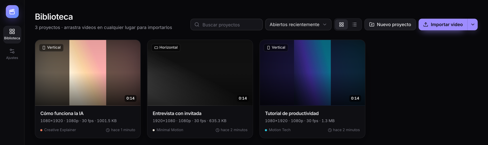
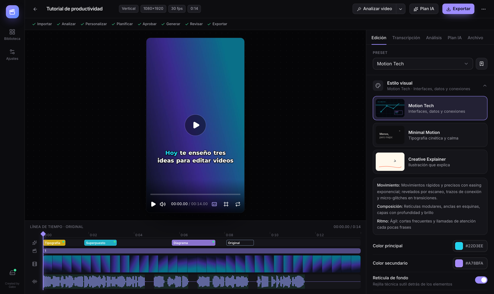
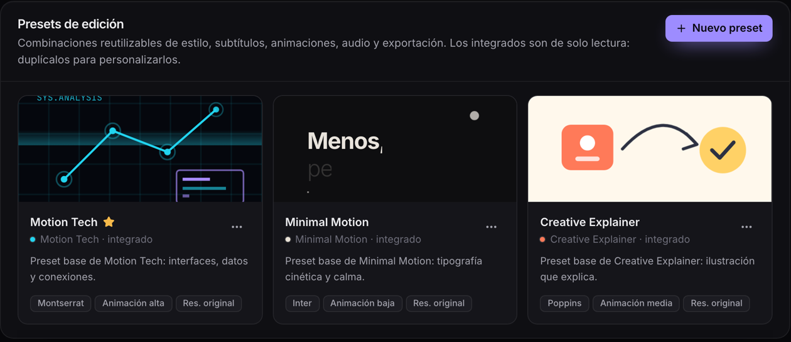

# Video Studio AI — Community Edition

**Editor de video con IA, gratuito y local.** Importa tu video, transcríbelo en tu equipo, deja que la IA proponga la edición y exporta con *motion graphics*, subtítulos y efectos de sonido. **Sin marcas de agua.**

*Created by Gabo* · Licencia MIT (código original) · macOS y Windows



## Qué hace
- 🎬 **Videos verticales y horizontales** (Reels, TikTok, YouTube), con zonas seguras de cada plataforma.
- 📝 **Transcripción local** con Whisper: tu audio no sale de tu equipo.
- 💬 **Subtítulos** animados y personalizables, sincronizados palabra a palabra.
- 🤖 **Plan de edición con IA** (Claude Opus 5.5): propone dónde y cómo animar; tú revisas, corriges y apruebas.
- ✨ **Animaciones generadas por código** (Remotion), con vista previa y regeneración de escenas.
- 🔊 **Efectos de sonido** creados por el propio programa (sin licencias de terceros).
- 📤 **Exportación MP4/MOV** verificada, sin marcas de agua.
- 🗂️ **Proyectos, versiones e historial**, con copias de seguridad automáticas.



## Tres estilos gratuitos
| Motion Tech | Minimal Motion | Creative Explainer |
|---|---|---|
| Interfaces, datos y conexiones | Tipografía cinética y calma | Ilustración que explica |



## Compatibilidad
| Sistema | Estado |
|---|---|
| macOS con Apple Silicon (M1 o superior) | ✅ **Validado** |
| macOS con Intel | ❌ No compatible por ahora |
| Windows 11 x64 (y Windows 10 x64) | 🟡 **Soporte implementado; pendiente de validación en un PC Windows real** |
| Windows en ARM | ❌ No compatible por ahora |

## Requisitos
- 8 GB de memoria (16 GB recomendados para 4K).
- ~6 GB libres en el disco del sistema, más el espacio de tus videos.
- Conexión a internet para instalar (y para usar Claude, si lo activas).
- **No** necesitas GPU, Docker, WSL ni permisos de administrador.

Más detalles: [docs/REQUIREMENTS.md](docs/REQUIREMENTS.md).

## Instalar con Claude Code (recomendado)
1. Abre **Claude Code** en tu ordenador.
2. Copia y pega este mensaje:

   ```
   Instala Video Studio AI desde https://github.com/CreaSinergIA/video-studio-ai. Clona el repositorio, lee su archivo CLAUDE.md y sigue sus instrucciones.
   ```

3. Claude Code te dirá qué necesita descargar y te pedirá permiso.
4. Al terminar, se abrirá el panel en tu navegador con la **primera configuración**.

No necesitas una clave de API para instalar, abrir el editor, importar videos ni usar las funciones locales.

## Instalar a mano
1. Descarga el proyecto: botón **Code → Download ZIP** (y descomprímelo) o `git clone https://github.com/CreaSinergIA/video-studio-ai.git`.
2. Haz doble clic en el instalador:
   - **macOS:** `Instalar Video Studio AI.command` (si macOS lo bloquea: clic derecho → Abrir).
   - **Windows:** `Instalar Video Studio AI.cmd` (si aparece SmartScreen: Más información → Ejecutar de todas formas).
3. Acepta las descargas que te propone. El instalador solo descarga lo que falta, verifica cada archivo y no instala nada de forma global.

Guías paso a paso: [macOS](docs/INSTALL-macOS.md) · [Windows](docs/INSTALL-Windows.md).

## Abrir el editor después
| macOS | Windows |
|---|---|
| App **Video Studio AI** (en tu carpeta Aplicaciones de usuario; puedes llevarla al Dock), o doble clic en `Video Studio AI.command` | Acceso directo **Video Studio AI** del Escritorio o del menú Inicio, o doble clic en `Video Studio AI.cmd` |

El panel se abre en tu navegador (normalmente `http://127.0.0.1:8775`) y solo es accesible desde tu equipo. Para cerrarlo: *Ajustes → Acerca de → Cerrar Video Studio AI*. Más: [docs/LAUNCHING.md](docs/LAUNCHING.md).

## Claude (opcional)
- **Gratis, sin clave:** importar, transcribir, revisar la transcripción, subtítulos y su estilo, presets, ajustes de audio y exportar.
- **Con tu clave de API de Anthropic:** el plan de edición y las animaciones que dirige Claude Opus 5.5.

Para activarlo, crea una clave en [platform.claude.com](https://platform.claude.com/settings/keys) y pégala en el panel (*primera configuración* o *Ajustes → Claude*). Se guarda en el llavero de tu sistema y puedes comprobarla **sin coste**, cambiarla o borrarla.

> **Software gratuito, API de pago.** Video Studio AI no cuesta nada. El uso de Claude desde el panel se factura por tokens en **tu** cuenta de Anthropic y **no está incluido en las suscripciones Claude Pro ni Max**. El panel muestra el precio, pide confirmación según un límite diario que tú eliges y nunca envía tus videos (solo la transcripción y algunos fotogramas reducidos). Más: [docs/CLAUDE.md](docs/CLAUDE.md).

## Actualizar
Pide a Claude Code: *«Actualiza Video Studio AI a la última versión siguiendo docs/UPDATING.md»*, o sigue [docs/UPDATING.md](docs/UPDATING.md). Tus proyectos, videos, ajustes y clave se conservan.

## Problemas frecuentes
| Problema | Solución |
|---|---|
| «Abre Video Studio AI desde su lanzador» | Ábrelo con el acceso directo o el `.command`/`.cmd`. |
| La instalación se cortó | Vuelve a ejecutar el instalador: continúa donde se quedó. |
| Windows: error de rutas largas | Mueve la carpeta a `C:\VideoStudioAI` y repite. |
| Falta el navegador de render o el modelo | *Ajustes → Animaciones* / *Ajustes → Transcripción* → Descargar. |
| La clave no funciona o no hay saldo | El panel explica el motivo; revisa tu cuenta en platform.claude.com. |

Diagnóstico: `./videostudio doctor` (macOS) o `videostudio.ps1 doctor` (Windows). Más: [docs/TROUBLESHOOTING.md](docs/TROUBLESHOOTING.md).

## Privacidad
Todo se procesa y se guarda en tu equipo. No hay cuentas, servidores, telemetría ni pagos de Video Studio AI. Tus datos viven en la carpeta de proyectos que elijas y en la carpeta de la aplicación (macOS: `~/Library/Application Support/VideoStudioAI-Community`; Windows: `%LOCALAPPDATA%\VideoStudioAI-Community`).

## Licencias
- **Código original:** [MIT](LICENSE), © 2026 Gabo. La licencia MIT cubre solo el código de este proyecto ([NOTICE](NOTICE)).
- **Remotion** (motor de animaciones) se instala por separado y tiene **su propia licencia**: gratuita para personas, organizaciones sin ánimo de lucro y empresas de hasta 3 personas; las organizaciones mayores necesitan su propia licencia ([remotion.pro/license](https://www.remotion.pro/license)). Cada usuario es responsable de cumplir sus condiciones.
- **FFmpeg, modelos Whisper, navegador de render, fuentes** y demás dependencias conservan sus licencias: [THIRD_PARTY_NOTICES.md](THIRD_PARTY_NOTICES.md).

Video Studio AI es un proyecto independiente: usa Claude de Anthropic, pero no está afiliado a Anthropic.

## Para desarrolladores
Arquitectura: [docs/ARCHITECTURE.md](docs/ARCHITECTURE.md) · Plataformas: [docs/PLATFORMS.md](docs/PLATFORMS.md) · Seguridad: [docs/SECURITY.md](docs/SECURITY.md) · Validación en Windows: [docs/WINDOWS-VALIDATION.md](docs/WINDOWS-VALIDATION.md).
```bash
./videostudio check            # lint, tipos, pruebas y compilación
cd frontend && npm run e2e     # pruebas E2E con medios sintéticos
```
